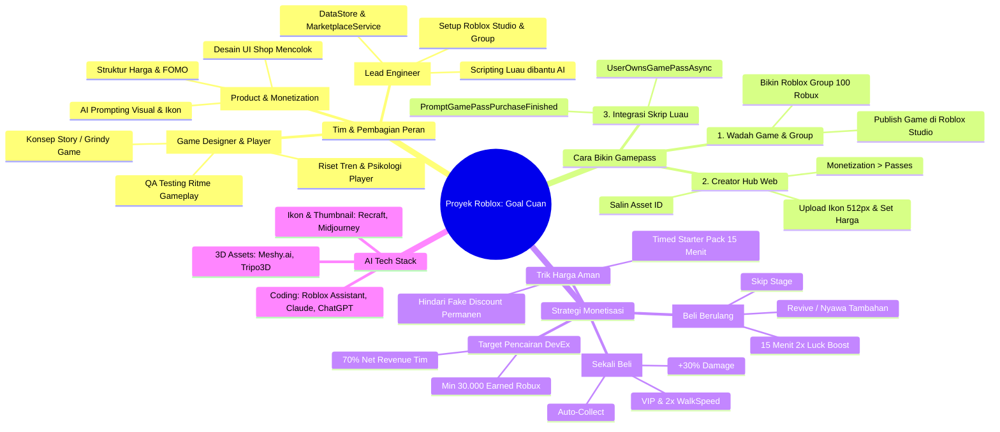
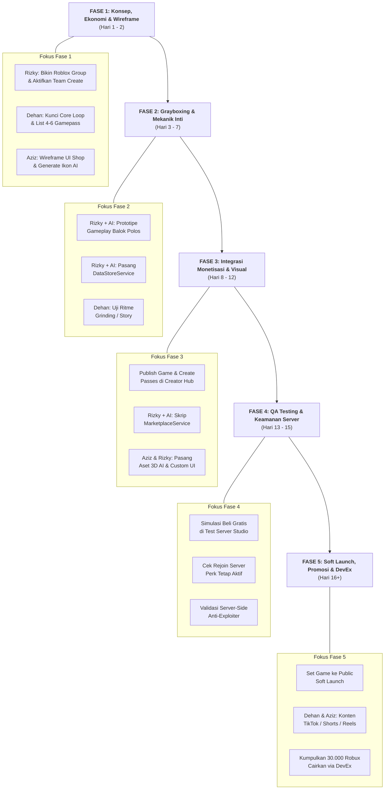
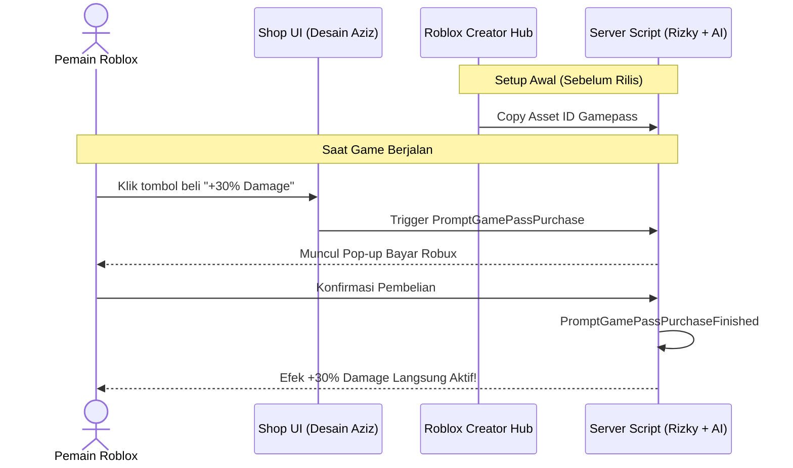

# 🚀 Blueprint & Mindmap Proyek Roblox

Dokumen ini memvisualisasikan seluruh strategi proyek *game* Roblox untuk tim (**Aziz, Dehan, Rizky**), mulai dari pembagian peran, cara teknis membuat *Gamepass*, *AI tech stack*, hingga alur tahapan *development* menuju target **DevEx**.

---

## 🧠 1. Master Mindmap Proyek & Monetisasi

---

## 🛠️ 2. Flowchart Tahapan Development (16+ Hari)

Diagram alur di bawah ini memetakan tahapan eksekusi berurutan untuk tim:

---

## ⚙️ 3. Alur Teknis Aktivasi Gamepass (Rizky & Aziz)

