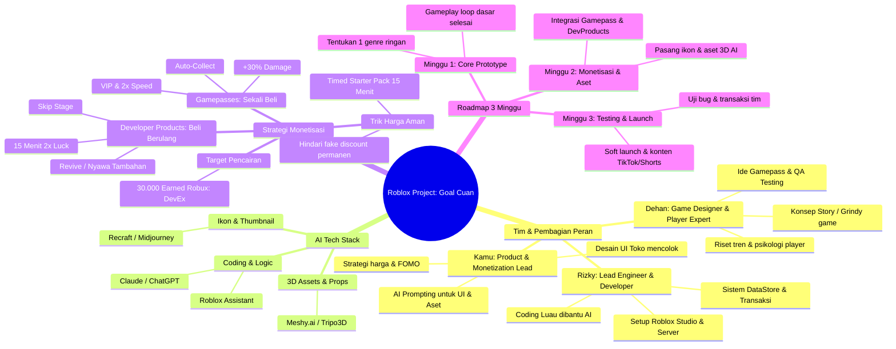

# 🚀 Mindmap Proyek Game Roblox: Misi Cuan

Dokumen ini berisi pemetaan strategi, pembagian peran tim (**Aziz, Dehan, Rizky**), *AI tech stack*, serta rencana monetisasi untuk membangun *game* Roblox yang cepat rilis dan menghasilkan pendapatan (*DevEx*).

---

## 📊 Visual Mindmap (Mermaid)

> *Catatan: Diagram di bawah ini dapat langsung dirender secara visual di aplikasi seperti Obsidian, Notion, GitHub, atau VS Code.*

---

## 🧠 Struktur Mindmap (Format Hierarki `.md`)

- **Proyek Game Roblox (Goal: Cuan / DevEx)**
  - **1. Tim & Pembagian Peran**
    - **Aziz (Product & Monetization Lead)**
      - Menentukan struktur harga *Gamepass* dan *bundling*
      - Merancang tampilan UI toko yang menarik perhatian pemain
      - Mengelola *prompt* AI untuk pembuatan aset visual dan ikon
    - **Dehan (Game Designer & Roblox Player Expert)**
      - Memberikan *insight* tren *game* yang sedang ramai dimainkan
      - Merancang *core gameplay* (*story game* atau *grindy simulator*)
      - Menentukan *perk* apa saja yang paling menggoda pemain untuk membeli
      - *QA Tester* utama untuk memastikan *game* seru dan tidak membosankan
    - **Rizky (Lead Engineer & Technical Architect)**
      - Mengelola proyek utama di dalam **Roblox Studio**
      - Mengembangkan skrip **Luau** dengan bantuan AI agar lebih cepat dan bersih
      - Membangun sistem *DataStore* (simpan progres pemain) dan validasi transaksi
      - Optimasi performa *game* agar lancar dimainkan di HP maupun PC
  - **2. AI Tech Stack (Percepatan Produksi)**
    - **Logika & Pemrograman:** Roblox Assistant, Claude, ChatGPT
    - **Aset 3D Instan:** Meshy.ai atau Tripo3D (objek *low-poly*, senjata, *pet*)
    - **Visual & Branding:** Recraft atau Midjourney (ikon bulat *Gamepass* & *Thumbnail*)
  - **3. Strategi Monetisasi (Cuan)**
    - **Gamepasses (Beli Sekali, Berlaku di 1 Game)**
      - *+30% Damage*, *VIP*, *2x WalkSpeed*, *Auto-Collect*
    - **Developer Products (Bisa Dibeli Berkali-kali)**
      - *Revive* (saat kalah), *2x Luck Boost* (durasi 15 menit), *Skip Stage*
    - **Psikologi Harga yang Aman (Anti-Banned)**
      - Gunakan **Timed Starter Pack** (diskon asli yang hanya muncul 15 menit pertama bagi pemain baru)
      - Hindari *fake discount* permanen agar aman dari moderasi Roblox
    - **Target Finansial**
      - Kumpulkan minimal **30.000 Earned Robux** untuk pencairan via **DevEx** ke Rupiah
  - **4. Roadmap Eksekusi (3 Minggu)**
    - **Minggu 1 (Prototipe):** Kunci 1 konsep sederhana -> Rizky & AI bangun mekanik dasar -> Dehan uji *gameplay*.
    - **Minggu 2 (Monetisasi & Visual):** Kamu siapkan ikon *Gamepass* -> Rizky integrasikan sistem pembayaran & *Starter Pack*.
    - **Minggu 3 (Testing & Rilis):** Uji coba transaksi di *test server* -> Rilis publik -> Buat video pendek (TikTok/Reels/Shorts) untuk mendatangkan pemain pertama.

---

## ⚡ Checklist Langkah Pertama (Hari 1 - 3)

- [ ] **Dehan:** Pilih 2–3 referensi *game* Roblox yang sedang tren dan mudah ditiru mekaniknya (*grindy* atau *story*).
- [ ] **Aziz:** Buat daftar 5 *Gamepass* dan 3 *Developer Products* beserta rencana harganya (misal: 25, 50, 99, 199 Robux).
- [ ] **Rizky:** Siapkan *project base* di Roblox Studio, aktifkan *API Services* (untuk *DataStore*), dan uji coba integrasi satu *Gamepass* dummy menggunakan bantuan AI.